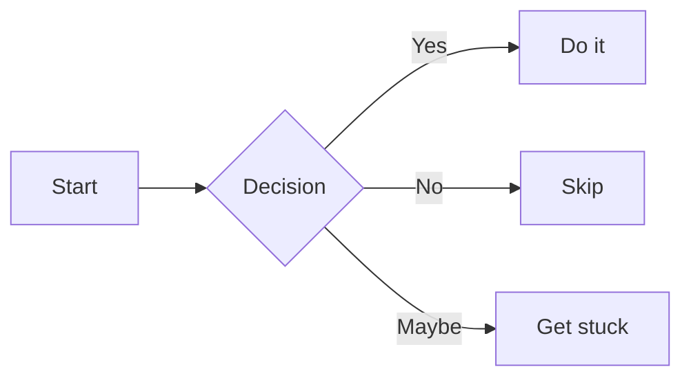

> Single quote
>
> > Nested quote
>
> - Lists and **formatting** work inside

> [!NOTE]
> Useful information.

> [!TIP]
> Helpful advice.

# see

> [!IMPORTANT]
> Key information.

> [!WARNING]
> Urgent attention needed.

> [!CAUTION]
> Risk of negative outcomes. 

~~~~
Anything here appears in a box with a copy button.
Great for prompts, commands, or text you want people to copy.
~~~~

`````js title="app.js" {2,4-5}
// the braces highlight lines 2 and 4 to 5
`````

$
\sum_{i=1}^{n} i = \frac{n(n+1)}{2}
$ amath

```geojson
{ "type": "Point", "coordinates": [5.78, 5.52] }
```

$\color{blue}{\text{This is red}}$
&nbsp;&nbsp;&nbsp;&nbsp;Indented text
&emsp;Wide space   &ensp;Medium space   &copy; &rarr; &check;

un**believ**able   (works)
un__believ__able   (doesn't)

- List one

<!-- -->

- List two (separate list)

<a id="my-anchor"></a>
[Jump there](#see)

## My Heading {#custom-id}

<details>
<summary>Show config</summary>

````yaml
key: value
````

</details>
%%hidden comment%%
> [!tip]- Collapsed callout
> Hidden until clicked

> [!tip]+ Expanded callout
> Visible, but can be collapsed




